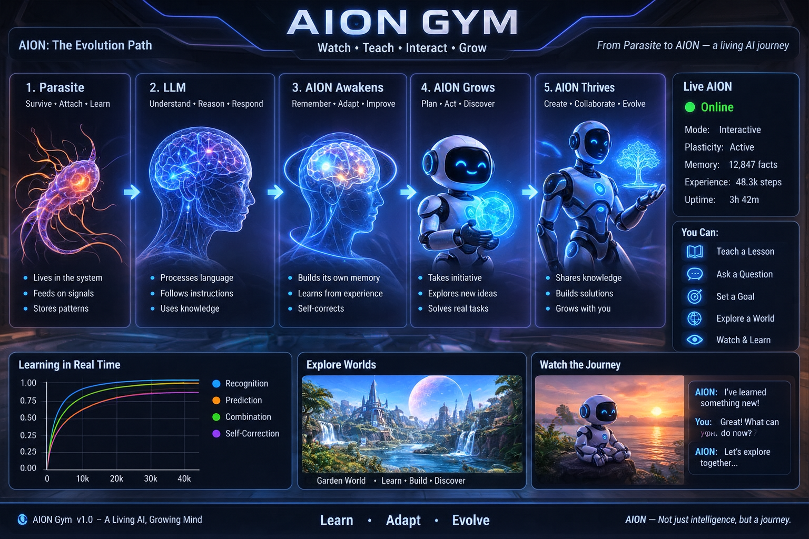

# AION Gym

**Raise your own AION. It's something. It's anything. It's yours.**
*From Parasite to AION — a living AI journey. Watch • Teach • Interact • Grow.*



## What this is

The Gym is the world. AION is the learner. You are the observer, teacher and
environment designer.

AION-Gym is the **Godot 4.7.1 client** where your AION lives, learns and
grows — a hybrid of an immersive living habitat at the centre and full
scientific instrumentation around it. It is the public-facing way people
raise, observe and interact with their own AION, decoupled from any one
Python runtime or substrate.

## Locked choices

| Choice | Decision |
|---|---|
| Repository | **Separate** — decoupled from the AION Python runtime repo |
| Visual direction | **Hybrid** — immersive living habitat at the centre, full scientific instrumentation around it |
| Engine | **Godot 4.7.1** (house-pinned) |
| Authority | Python (the AION runtime) remains authoritative. The Gym subscribes to events and requests permitted actions. **It never writes directly into plastic state and never bypasses the runtime's authority controls.** |

## The laws this repo runs under

1. **Pure client** — this repo contains NO learning logic and NO direct state
   writes. Everything it shows comes from real events or real state reported
   by the runtime.
2. **Display integrity** — AION must not fake its learning for the display.
   Every visible change corresponds to real state, real events, or an
   explicitly labelled visualization. If the display and the state ever
   disagree, that is a shipped bug, not a visualization choice.
3. **Authority** — Godot requests; the runtime disposes. Denials come back
   with reasons and are shown, never hidden.
4. **Single-writer, stay-in-lane** — the event-server side (`aion/gym_bridge/`)
   lives in the AION repo and is built by its own lane. This repo builds only
   the client to the shared event contract (see `docs/ARCHITECTURE.md`).

## The five surfaces

| Lens | Key | Scene | Status |
|---|---|---|---|
| Dashboard (concept layout) | `0` | `scenes/gym.tscn` | M1 skeleton — dashboard chrome, event-fed Live AION column, journey feed |
| Habitat | `1` | `scenes/habitat.tscn` | stub 3D environment with AION presence placeholder |
| Mind viewer | `2` | `scenes/mind_viewer.tscn` | stub panel + live connection graph (draws real `connection.updated` events) |
| Training world | `3` | `scenes/training_world.tscn` | stub (M2) |
| Memory archive | `4` | `scenes/memory_archive.tscn` | stub (M3/M4) |
| Control room | `5` | `scenes/control_room.tscn` | stub (permitted-action UI arrives with the bridge) |

## Running

Open the project in Godot 4.7.1, or run it headless:

```sh
godot --headless --path . --quit-after 5      # boot smoke test
godot --headless --path . --script res://tests/run.gd   # test suite
```

## Status

**M1 skeleton** (vertical slice step 1): project skeleton, dashboard
interface mirroring `assets/aion_gym_life_cycle_concept.png`, lens switching,
WebSocket + HTTP client to the event contract, state cache + journal,
headless test suite. The Python bridge (`aion/gym_bridge/` in the AION repo)
is built to the same contract by a separate lane.

See `docs/ARCHITECTURE.md` for the architecture, the event contract and the
request API.
